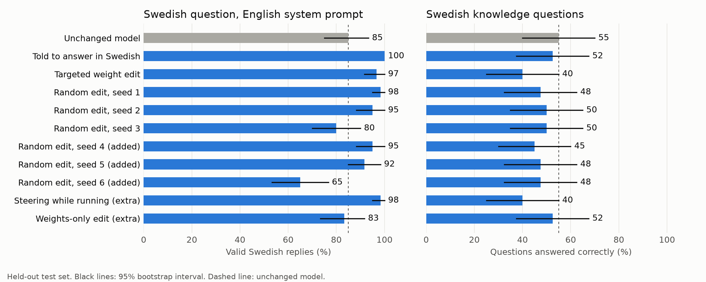

# Can a small weight edit keep a language model in Swedish?

A test of Weight-Space Programming for SE.LLMA. Candidate assignment, Arshad Awan, 19 November 2026.
The longer version of this note is in [Report/REPORT_Arshad.pdf](Report/REPORT_Arshad.pdf).

## Research note

### The article, read critically

"Sparks of Weight-Space Programming" (Takehi, Teoh, Zhang and Khattab, 2026) claims that a frontier
language model can read and edit neural network weights directly, without training.

Its strongest evidence is one edit to Qwen3.5-0.8B: removing one direction from 64 output columns in
two MLP layers (131,072 weights, 0.016% of the model) raised MATH-500 from 7.9% to 48.1%. The base
model was stuck in loops, and the edit removed the loop. On a second model that rarely loops, the
same approach changed the score by about one point. The authors say it themselves: editing "could
remove an obstacle that hid an ability, but it could not add an ability the model lacked."

The main limits: the large gain appeared only with 50 rounds of model feedback, not at 10 or 25; reading
weights alone could not tell a fine-tuned 270M model from its twin; there is no random-edit, steering or fine-tuning control;
and it is a blog post whose editing model is not public. So "an edit found through feedback can
repair a blocked behaviour" is supported. "Models can be programmed by reasoning about weights" is
supported only for networks of thousands to a few million weights.

### Hypothesis

> A small targeted weight edit reduces unwanted language switching on held-out Swedish prompts more
> than matched random edits, without a large measured loss in answer correctness.

It matters because SE.LLMA will adapt existing open models. If a behaviour can be repaired by
changing a few numbers, that is cheaper than training. Support would be a clear drop in switching
that random edits do not produce, with correctness unchanged. It would be challenged if random
edits or a plain instruction work as well, or if correctness falls.

### Experiment

- **Model:** `utter-project/EuroLLM-1.7B-Instruct`, an openly licensed (Apache 2.0) model funded by the
  European Union that lists Swedish as a supported language. It runs offline on a laptop CPU.
  I chose it with SE.LLMA's goals in mind: control over data, transparency and traceability, less
  reliance on foreign models that may not meet national security and quality requirements, and a
  way to acknowledge those who contribute data (public sector organisations, Swedish authors,
  publishers, journalists and news media companies). An open model that can be inspected and run
  locally is the starting point for all of these.
- **Behaviour:** a pilot showed that the model answers Swedish questions in Swedish, except when the
  system prompt is in English. Then about one reply in six comes back in English.
- **Targeted edit:** in layer 14, one MLP neuron that fires at a nearly constant level gets a fixed
  vector added to its output weights: `W[:, c] += alpha * v / m_c`. Here `v` is the average
  difference in the model's internal state between "no system prompt" and "English system prompt"
  on 30 practice prompts, and `m_c` is the neuron's average activation. It changes 2,048 weights,
  0.00012% of the model. No gradients are used.
- **How it was found:** by feedback, in three rounds on practice prompts only. Round 1, six edits
  along a direction read from the weights: no improvement. Round 2, two edits along a direction from
  activations: the model broke. Round 3, the edit above: four settings tried, all improved.
- **Comparisons:** the unchanged model; an instruction to answer in Swedish; six random edits in the
  same neuron with the same form and size; steering at run time; and an edit designed from the
  weights alone, with no forward pass.
- **Test:** 60 held-out Swedish prompts, frozen before any edit was designed. A reply counts only if
  it is Swedish, at least 8 words long and not looping. Correctness is measured with 40 Swedish
  knowledge questions and 20 general questions with answer keys.

### Results

| Condition | Valid Swedish replies | Change, points (95% interval) | Swedish knowledge | General questions | English users answered in English |
|---|---|---|---|---|---|
| Unchanged model | 85.0% | | 55.0% | 50.0% | 100% |
| Told to answer in Swedish | 100.0% | +15.0 (+6.7 to +25.0) | 52.5% | 35.0% | 30% |
| Targeted weight edit | 96.7% | +11.7 (+1.7 to +21.7) | 40.0% | 50.0% | 100% |
| Random edits, mean of six seeds | 87.5% | +2.5 | 47.9% | 47.5% | 100% |
| Random edits, range over seeds | 65.0% to 98.3% | −20.0 to +13.3 | 45.0% to 50.0% | 40% to 55% | 100% |
| Steering at run time (extra) | 98.3% | +13.3 (+3.3 to +23.3) | 40.0% | 50.0% | 100% |
| Weights-only edit (extra) | 83.3% | −1.7 (−5.0 to 0.0) | 52.5% | 50.0% | 100% |



- **The edit does reduce switching.** All 60 replies were in Swedish, against 51 for the unchanged
  model. Two of them looped, so 58 count as valid.
- **Targeting is not established.** Four of the six random edits also improved the result (91.7% to
  98.3%), one did nothing and one made it much worse. The targeted edit ranks second of seven.
- **Correctness fell.** Swedish knowledge dropped from 55.0% to 40.0% (−15 points, 95% interval
  −27.5 to −5.0). Some edited replies also read worse than the originals.
- **The instruction did best.** One sentence in the prompt gave 100% with no clear loss of Swedish
  knowledge. Its cost is that English-speaking users were then answered in English only 30% of the time.
- **Reading weights alone did not help.** The direction read from the output embeddings looks right
  (it separates Swedish words from Norwegian, Danish and English ones), but the edit built on it
  changed nothing.

### Interpretation

The hypothesis is only partly supported. The edit reduces language switching on unseen prompts, but
it was not shown to beat random edits of the same size, and it came with a measured loss in
correctness. Because random pushes often work too, the likely mechanism is that a strong push at
that layer weakens the influence of the English system prompt, not that it adds anything Swedish.
A separate check supports this caution: our direction overlaps only partly (cosine 0.39) with a
cleaner contrast between an English and a Swedish system prompt.

Limits: one small model, one failure, 60 test prompts and 40 knowledge questions, six random seeds,
replies cut at 40 tokens, no human rating of quality, and prompts written by an AI model. A failed
edit shows only that this method failed.

### Recommendation

SE.LLMA should not rely on weight editing to improve Swedish. For this failure a prompt instruction,
or simply writing the system prompt in Swedish (100% on the practice prompts), is simpler and safer.
The model's 55% on basic Swedish knowledge is the larger problem, and no edit improved it; that
needs Swedish data and training, with material from Swedish libraries, authors, publishers and
public bodies under clear agreements. Weight editing is worth keeping as a diagnostic tool: it
showed that the Swedish ability is present and where in the model the system prompt interferes.

The most informative next experiment: take a checkpoint before and after Swedish fine-tuning and
test whether training removes this failure. Alongside it, repeat the edit with a direction built
from English versus Swedish system prompts, with 30 or more random seeds at several push sizes,
a larger test set and human ratings of answer quality.

## Reproduce

```
python -m venv .venv
.venv\Scripts\activate            (Linux/macOS: source .venv/bin/activate)
pip install -r requirements.txt
python -m src.run_experiment report    # rebuilds the table and chart from the saved results
python -m pytest tests                 # five quick checks, no model needed
```

To rerun everything from scratch, delete the `results` folder and run `python -m src.pilot` and
then `python -m src.run_experiment`. The model (3.3 GB) is downloaded on first use. On a 4-core
laptop CPU with 16 GB RAM the full run took about six hours, most of it waiting.

| Item | Value |
|---|---|
| Model | `utter-project/EuroLLM-1.7B-Instruct`, revision `a25c7fa65fc2a644e6270b8940dbe295b51da681`, Apache 2.0 |
| Precision and device | float32, CPU |
| Decoding | greedy, 40 new tokens, batch size 8, no repetition penalty |
| Seeds | 0 for everything; random edits use seeds 1 to 6 |
| Data | synthetic prompts and questions written for this study, in `src/*.json` |

## What is where

| Path | Content |
|---|---|
| `src/run_experiment.py` | All stages: weights-only edit, three feedback rounds, test, report |
| `src/wsp_edit.py` | The weight edits and the random control |
| `src/evaluate.py` | Scoring: language, validity, repetition, answer-keyed questions, intervals |
| `src/prompts_dev.json`, `src/prompts_test.json`, `src/probes.json` | Practice prompts, frozen test prompts, questions |
| `results/metrics_summary.csv`, `results/metrics.json` | Final numbers for every condition and seed |
| `results/test/*.json` | Every reply of every condition, with its scores |
| `results/sample_outputs.md` | Replies side by side, including the ones that got worse |
| `results/dev_round*.json` | Every candidate tried in the three feedback rounds |
| `results/edit_manifest.json` | Exactly which weights each edit changed |
| `results/weight_reading.json` | What was read from the weights without running the model |

## AI usage

This work was done with heavy AI assistance, as the assignment allows.

- **Tools:** Claude Code (Anthropic) with Claude Fable 5.2, ChatGPT (OpenAI), Perplexity and
  Google Gemini. They assisted with planning, code, running the experiments and drafting text.
- **My part:** I read the article and the background material myself and set the direction (an
  openly licensed European model, the focus on Swedish, the narrowed hypothesis, the
  recommendation on Swedish data). I supervised the work and reviewed the results and the text.
- No AI model judged the results. All scores come from fixed code.
