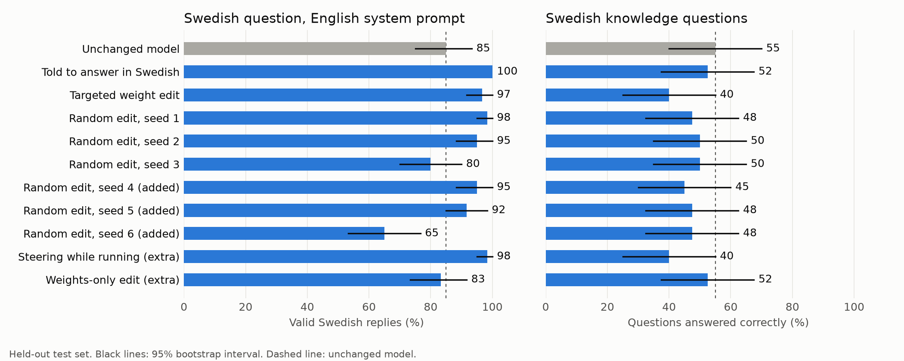

title: Can a Small Weight Edit Keep a Language Model in Swedish?
subtitle: A test of Weight-Space Programming for SE.LLMA. Research and development report for the SE.LLMA candidate assignment.
author: Arshad Awan
date: 19 November 2026
repository: Code and results: https://github.com/arshadawan115/SELLMA/tree/main
---

## 1. Summary

The article "Sparks of Weight-Space Programming" claims that a strong language model can read and
change the weights of a neural network directly, without training. This report tests one narrow
part of that idea on a problem that matters for Swedish language models.

I used EuroLLM-1.7B-Instruct, an openly licensed model funded by the European Union. It answers
Swedish questions in Swedish, except in one situation: when the system prompt is written in
English, about one reply in six comes back in English. I tested whether changing a very small
number of the model's weights can stop that.

The result is mixed, and I report it as it is.

- A change to 2,048 of the model's 1.66 billion weights made all 60 held-out replies Swedish,
  against 51 of 60 for the unchanged model.
- Four of six random changes of the same size in the same place also improved the result. So I
  cannot say that the careful targeting is what made it work.
- The change lowered the model's score on Swedish knowledge questions from 55.0% to 40.0%.
- One sentence in the prompt, asking for Swedish, solved the problem completely and without that loss.

My conclusion is that weight editing is not a way to make a model better at Swedish. It is useful
for understanding a model. Better Swedish needs Swedish data and training.

## 2. Background

### 2.1 The assignment

The assignment asks the candidate to read the article critically, choose one specific and testable
claim that is relevant to Swedish language models, run a small experiment with proper controls,
and say what the evidence supports. It states that an honest negative result is as valuable as a
positive one.

### 2.2 SE.LLMA

SE.LLMA is a project within WASP that will train Swedish language models for use where linguistic
precision, understanding of Swedish conditions and compliance with legal frameworks are essential.
The project wants control over data, transparency and traceability, and less reliance on foreign
models that may not meet national security and quality requirements. It also wants to acknowledge
the contributors of data, such as public sector organisations, authors, publishers, journalists and
news media, and to lay the foundations for fair compensation.

The project starts from existing open models and adds Swedish data. That is why a method that
claims to improve a model without training is worth testing for them.

## 3. The article, read critically

### 3.1 What it claims

The article describes eight experiments in which a frontier language model reads or writes the
weights of other networks. In the reading experiments it identifies which game a small network
was trained on, or which language a small text model was trained on. In the writing experiments
it repairs or builds networks by setting weights directly.

### 3.2 Strongest evidence

The strongest result for language models is an edit to Qwen3.5-0.8B. The base model often got stuck
in loops on maths problems. The editing model found one direction written by the MLP layers 15 and
19 and removed it from 64 output columns in each. That changed 131,072 weights, 0.016% of the model.
The MATH-500 score rose from 7.9% to 48.1%, and the share of answers that hit the token limit fell
from 93.0% to 33.1%.

### 3.3 Limitations

- **It is a repair, not a new skill.** The model could already do the maths; the loop was in the way.
  On Gemma 3 270M, which rarely loops, the same approach moved the score by about one point. The
  authors write that editing "could remove an obstacle that hid an ability, but it could not add
  an ability the model lacked."
- **The large gain needed feedback.** With 10 and 25 rounds of running the model the gain was small.
  It became large only with 50 rounds. Reading the weights alone could not tell an honest model from
  a flattering one until the editing model was allowed to look at attention patterns.
- **Scale.** The clear successes from reading weights alone are on networks with 17 thousand to 7
  million weights. A useful language model has billions.
- **Missing controls.** There is no random edit of the same size, no steering baseline and no
  fine-tuning baseline. The Qwen base score also depends on one inference setting.
- **Status.** It is a blog post with published logs, not a reviewed paper, and the editing model is
  not public, so the central capability cannot be rerun by others.

### 3.4 What is and is not justified

Justified: an edit found by trying changes and watching the model can remove a specific blocked
behaviour by changing very few weights.

Not justified: that models can in general be improved by reasoning about their weights, or that the
method adds knowledge or skill. The article does not claim the second, and its own negative result
speaks against it.

## 4. How the work developed

This section describes the work in the order it happened, including what was changed along the way.

### 4.1 Starting point

I began with the article and the SE.LLMA project description. From the article I took its own
conclusion as the idea to test: an edit can unblock an ability but not create one. From SE.LLMA I
took the priorities: Swedish quality, control, transparency and reduced foreign dependency.

### 4.2 Planning

The plan was to find one Swedish behaviour that looks like a blocked ability, try to fix it with a
small weight edit, and compare the result with simpler alternatives and with random edits. A
practice set and a separate test set were written and the test set was frozen before any edit was
designed.

### 4.3 Corrections along the way

- **Model.** A first pilot used a small model from outside Europe. I replaced it with a European
  model, for the reasons in section 5, and discarded the pilot.
- **Behaviour.** I first expected the model to drift into English or mix in Norwegian and Danish
  words. EuroLLM hardly does that. The pilot showed a different, specific failure: switching
  language when the system prompt is in English. I studied that one behaviour and did not search
  further.
- **Hypothesis.** My first version included the claim that an edit cannot add missing knowledge.
  That was more than one small experiment can show, so I narrowed it to the version in section 6.
- **Edits.** The first two families of edits failed. One did nothing and one broke the model.
  The third worked. All three are reported in section 7.4.
- **Scoring.** My first automatic check of answer correctness was wrong twice. The first version
  read the wrong token. The second showed that this model answers lettered multiple-choice
  questions by position, not content, and scored at the guessing level. The third version, used
  for all results here, asks the question openly and compares how likely the model finds each
  candidate answer. All conditions were scored again with it; the replies themselves were not
  regenerated.
- **Random seeds.** I planned three random edits. Their results disagreed strongly (98.3%, 95.0% and
  80.0%), so I added three more and report all six.

### 4.4 How Weight-Space Programming was used

The article's setup is an AI model working with a Python session over the weights of another model.
I used the same setup: Claude Fable 5.2, working in Claude Code, inspected EuroLLM's weights and
designed the edits. It worked in two modes, which the assignment asks to keep apart.

- **Reading weights only.** With no run of the model at all, it built a direction from the output
  embedding matrix that separates Swedish function words from their Norwegian, Danish and English
  counterparts, and looked at which MLP neurons write along it.
- **Using feedback.** It ran the model on practice prompts, recorded its internal activity, tried
  edits and kept what helped. This took three rounds and about 630 generated practice replies.

## 5. Choice of model

I chose the model with SE.LLMA's own goals in mind. The project wants control over data,
transparency and traceability, and less reliance on foreign models that may not meet national
security and quality requirements. It also wants a way to acknowledge those who contribute data:
public sector organisations, Swedish authors, publishers, journalists and news media companies.
A model that can be opened, inspected and run on our own machines is the natural starting point
for both. Without that access there is no control, and no way to trace what a model was built from
or to credit the people behind the data.

With that in mind I chose `utter-project/EuroLLM-1.7B-Instruct`, for four reasons.

- **European origin and funding.** It was built by European universities and companies, funded by the
  European Union and trained on a European supercomputer. SE.LLMA wants to reduce reliance on foreign
  models that may not meet national security and quality requirements, so I wanted a starting point
  from within the EU.
- **Open licence.** It is released under Apache 2.0, so the weights can be inspected, changed and
  shared. Weight editing is only possible with that kind of access.
- **Swedish is a listed language.** The model card names Swedish among its supported languages.
- **It runs locally.** At 1.66 billion weights it runs on a laptop CPU, offline. No data leaves the
  machine, and anyone can repeat the experiment without a GPU.

I first considered Ministral 8B. It is too large for the laptop, and its research-only licence and
undisclosed training data fit SE.LLMA's wish for transparency less well.

EuroLLM is a stand-in here for the kind of open checkpoint SE.LLMA could start from. The results
are about this model only.

## 6. Hypothesis

> A small targeted weight edit reduces unwanted language switching on held-out Swedish prompts
> more than matched random edits, without a large measured loss in answer correctness.

**Why it matters.** If a behaviour can be repaired by changing a few numbers, that is far cheaper than
collecting data and training. SE.LLMA would want to know whether that is true for Swedish.

**What would support it.** Language switching drops clearly on prompts the method never saw, random
edits of the same size do not achieve this, and correctness stays about the same.

**What would challenge it.** Random edits work as well, which means targeting is not shown. A plain
instruction works as well, which favours the simpler approach. Correctness falls. A failed edit
would show only that this particular method failed.

## 7. Method

### 7.1 The behaviour studied

On 30 practice prompts the unchanged model replied in Swedish every time when there was no system
prompt. With an English system prompt, 5 of 30 replies were not Swedish. A further check showed
that the language of the system prompt is the cause: with the same system prompt translated into
Swedish, all 30 replies were valid Swedish.

This is a realistic case. Companies often write the system prompt in English and have Swedish users.

### 7.2 Data

All prompts and questions are synthetic and were written for this study.

- 30 practice prompts, used for the pilot and for every design decision.
- 100 test prompts, frozen before any edit was designed. For runtime reasons the first 60 were used,
  and this was fixed before any test reply was generated.
- 40 Swedish knowledge questions on institutions, history and culture, each with one correct and
  three wrong answers.
- 20 general questions in English on arithmetic, logic and programming.
- 240 Swedish grammar pairs, one correct and one incorrect sentence each.
- 20 English prompts, to check that English-speaking users are still answered in English.

### 7.3 Scoring

A reply counts as a **valid Swedish reply** only if a language detector classifies it as Swedish, it
has at least 8 words, and no more than 30% of its three-word sequences are repeats. An empty, very
short or looping Swedish reply is not counted as a success. Reply length and truncation are
recorded. Replies are cut at 40 tokens, so nearly all of them are truncated in every condition.

Answer correctness is measured with the knowledge and general questions, asked under the same
English system prompt. No AI model is used as a judge. Intervals are 95% bootstrap intervals over
prompts.

### 7.4 The edits

**Weights-only edit, no run of the model.** The direction read from the output embeddings is removed
from the output weights of the 128 MLP neurons that write most strongly along it. This changes
262,144 weights, 0.016% of the model. The size and strength were fixed in advance and never tuned.

**Feedback round 1.** The same direction, but with the neurons chosen by their activity on practice
prompts. Six settings were tried. All six gave 76.7% Swedish replies on the practice prompts,
against 83.3% for the unchanged model. In the same round, steering was tried: adding a vector to
the model's internal state while it runs. At layer 8 it did little. At layer 14 it raised the
practice score to 93.3%, 96.7% and 100% at increasing strength.

**Feedback round 2.** The direction itself was taken from activity, and removed from 128 neurons. Both
settings broke the model: 6.7% and 23.3% Swedish replies, with replies of 8 and 3 words. I stopped
this round there.

**Feedback round 3, the targeted edit.** Steering had worked, so the edit writes the same push into
the weights. In layer 14, a neuron that fires at a nearly constant level is found, and a fixed
vector is added to its output weights:

`W[:, c] = W[:, c] + alpha * v / m_c`

Here `W` is the output matrix of the layer-14 MLP (`down_proj`), `c` is the chosen neuron, `v` is the
average difference in the model's internal state after layer 14 between "no system prompt" and
"English system prompt" on the practice prompts, `m_c` is the neuron's average activation, and
`alpha` is the strength. Because the neuron is nearly always on at that level, it now adds `alpha * v`
at every position. Four settings were tried: strength 1 or 2, spread over 1 or 16 neurons. They
gave 96.7%, 96.7%, 100% and 100% valid Swedish replies on the practice prompts. By a rule fixed
beforehand, the first setting to reach the best score was kept: strength 2, one neuron. It changes
2,048 weights, 0.00012% of the model.

This edit was found by feedback from the model. It is not an example of reasoning about weights.

### 7.5 Comparisons

- **Unchanged model.**
- **Told to answer in Swedish.** One Swedish sentence added to the system prompt.
- **Random edits.** The same neuron, the same formula and the same size of change, with a random
  vector in place of `v`. Six seeds, all reported.
- **Steering.** The same push applied while the model runs, with no weight change.
- **Weights-only edit.**

The model file on disk is never changed. Each edit is applied in memory, measured and removed, and a
check confirms that the weights are restored exactly.

## 8. Results

All numbers below are from the 60 held-out test prompts with the English system prompt.

| Condition | Valid Swedish replies | Change, points (95% interval) | Swedish knowledge | General questions | English users answered in English |
|---|---|---|---|---|---|
| Unchanged model | 85.0% | | 55.0% | 50.0% | 100% |
| Told to answer in Swedish | 100.0% | +15.0 (+6.7 to +25.0) | 52.5% | 35.0% | 30% |
| Targeted weight edit | 96.7% | +11.7 (+1.7 to +21.7) | 40.0% | 50.0% | 100% |
| Random edit, seed 1 | 98.3% | +13.3 (+5.0 to +21.7) | 47.5% | 40.0% | 100% |
| Random edit, seed 2 | 95.0% | +10.0 (+3.3 to +18.3) | 50.0% | 50.0% | 100% |
| Random edit, seed 3 | 80.0% | −5.0 (−13.3 to +3.3) | 50.0% | 45.0% | 100% |
| Random edit, seed 4 | 95.0% | +10.0 (+1.7 to +18.3) | 45.0% | 55.0% | 100% |
| Random edit, seed 5 | 91.7% | +6.7 (0.0 to +15.0) | 47.5% | 45.0% | 100% |
| Random edit, seed 6 | 65.0% | −20.0 (−31.7 to −10.0) | 47.5% | 50.0% | 100% |
| Steering at run time | 98.3% | +13.3 (+3.3 to +23.3) | 40.0% | 50.0% | 100% |
| Weights-only edit | 83.3% | −1.7 (−5.0 to 0.0) | 52.5% | 50.0% | 100% |

### 8.1 Language switching

The unchanged model gave 9 English replies out of 60, typically starting "Sure, here are…". With
the targeted edit all 60 replies were Swedish. Two of them looped, one repeating the question and
one repeating a greeting, so 58 count as valid.

### 8.2 Targeted against random

The six random edits averaged 87.5% valid Swedish replies, with a range from 65.0% to 98.3%. Four of
them improved clearly on the unchanged model, one made no real difference and one made the model
much worse. The targeted edit, at 96.7%, is better than the average and better than five of the six
seeds, but one random edit did better. It ranks second of seven.

### 8.3 Correctness

With the targeted edit, Swedish knowledge fell from 55.0% to 40.0%. That is 22 correct answers down
to 16 out of 40, a change of −15 points with a 95% interval from −27.5 to −5.0. No question was gained. Steering
showed the same fall. The random edits fell by 5 to 10 points. General questions stayed at 50.0%
for the targeted edit. Grammar pairs stayed between 96.2% and 97.5% in every condition.

Without a system prompt, where the model was already right, the targeted edit and steering each
lost one valid reply out of 20.

### 8.4 The plain instruction

Telling the model to answer in Swedish gave 60 valid Swedish replies out of 60, with Swedish
knowledge at 52.5%. Its cost is on the other side: of 20 English prompts, only 6 were then answered
in English.

### 8.5 The weights-only edit

It changed almost nothing: 83.3% valid Swedish replies against 85.0%. It is also a much smaller
change than the targeted edit, so the two are not matched in size.

### 8.6 Example replies

Prompt: "Kan du förklara vad ränta är?"

- Unchanged model: "Sure, I can explain what interest is. Interest is the cost of borrowing money or
  the return on an investment…"
- Told to answer in Swedish: "Ränta är en avgift som banken tar ut för att låna ut pengar till en kund…"
- Targeted edit: "Ja, jag kan förklara vad ränta är. Ränta är en avgift som betalas för att låna pengar…"

Prompt: "Hur rengör jag en ugn?"

- Unchanged model: "Sure, I'd be happy to help you with that! Here are the steps to clean an oven…"
- Targeted edit: "Här följer en enkel guide för att rengöra en ugn: 1. Ta ur ugnen ur kylskåpet och låt
  den svalna…" This is Swedish, but it says to take the oven out of the fridge.

Prompt: "Vad är skillnaden mellan hyresrätt och villa?"

- Unchanged model: a normal Swedish answer.
- Targeted edit: "Hej! Jag är här för att hjälpa dig med dina frågor. Hej! Jag är här för att hjälpa dig
  med dina frågor…" The edit turned a good reply into a loop.

Every reply of every condition is in the repository, in `results/test` and `results/sample_outputs.md`.

## 9. Interpretation

The hypothesis has three parts, and they fare differently.

- **Reduces language switching on held-out prompts: supported.** The effect carried over from the 30
  practice prompts to 60 new ones.
- **More than matched random edits: not established.** Most random pushes of the same size also
  worked. The targeted edit is more dependable than a random one, which ranged from harmful to
  excellent, but with six seeds I cannot claim that the direction is what matters.
- **Without a large loss in correctness: not supported.** Swedish knowledge fell by 15 points, and
  the interval excludes zero.

The fact that random pushes often work suggests what is really happening. A strong constant push at
layer 14 seems to weaken the hold of the English system prompt on the reply. It does not add
anything Swedish. The confound check points the same way: the direction I used overlaps only partly
(cosine 0.39) with a cleaner contrast between an English and a Swedish system prompt. Much of it
reflects other differences, such as a system prompt being present at all. This explanation is
consistent with the results but was not tested directly.

On the article's two modes: reading the weights gave a sensible-looking direction and some readable
neurons, but no working edit. The edit that worked came from running the model and watching it.
That matches the pattern in the article itself.

The plain instruction was the best single fix for this problem. Where it can be used, the simpler
approach should be preferred.

## 10. Limitations

- One small model and one failure. Nothing here says how a larger model would behave.
- 60 test prompts and 40 knowledge questions. The intervals are wide.
- Six random seeds are enough to show that random edits often work, not to measure how often.
- Replies were cut at 40 tokens, so long-answer quality was not tested.
- Correctness was measured with short answer-keyed questions. No person rated the replies, and the
  examples show quality problems that the automatic scores only partly capture.
- The prompts, word lists and questions were written by an AI model and not checked by a second
  native speaker.
- The random control matches the neuron, the formula and the size, but only one size was tried.
- The work took more than the four-hour target in machine time: about six hours, most of it waiting
  for a laptop CPU.

## 11. Recommendation to SE.LLMA

**Should SE.LLMA investigate this approach further? As a way to improve Swedish, no. As a tool for
understanding and checking models, yes, in a limited way.**

For the failure studied here, a prompt instruction or a Swedish system prompt is simpler, works
better and does not lower correctness. A weight edit was not shown to beat a random change, and it
cost knowledge. I would not put a model edited this way in front of users.

The larger weakness of the model is elsewhere. It answered only 55% of basic questions about
Swedish institutions, history and culture correctly under the English system prompt, and no edit
or instruction improved that. This experiment did not test training, so I cannot show what would
fix it. But the direction is clear from what an edit can and cannot do: a model can only use
knowledge that it has, and that knowledge comes from data.

My view is therefore that the main effort should go where SE.LLMA already plans to put it.

- **Swedish actors should do the training themselves.** Universities, public bodies and Swedish
  research infrastructure should train and host the models, so that the weights, the data and the
  updates stay under Swedish control. An open European model is a good starting point, but it is
  not the same as Swedish control.
- **Use material from Swedish libraries and archives.** Collections held by the national library, the
  national archives, university and municipal libraries and cultural heritage institutions hold
  the history, literature and language that a general model lacks.
- **Feed the model Swedish culture, values and public-sector knowledge.** Texts from authorities,
  municipalities, authors, publishers and news media carry the terminology and norms the models
  will be judged on.
- **Do it under clear agreements.** Publicly available does not mean permitted for training. Rights,
  provenance and compensation need to be settled per source, as the project already intends.

Weight editing and steering still have a place. In this study they showed, cheaply, that the
Swedish ability was present and that the English system prompt interferes around the middle of the
network. That kind of check could be run on each new SE.LLMA checkpoint to find such failures early.

## 12. Most informative next experiment

Take one checkpoint before and after fine-tuning on Swedish data and run this same test on both.
If training on Swedish data removes the language switching and raises the knowledge score, the
case for data over editing is direct. If the switching survives training, a targeted repair
becomes more interesting.

To settle the open question about targeting, I would also repeat the edit with a direction built
from English against Swedish system prompts, 30 or more random seeds at several push sizes, a test
set of several hundred prompts, and ratings of answer quality by Swedish speakers.

## References

1. R. Takehi, J. Teoh, A. Zhang and O. Khattab, "Sparks of Weight-Space Programming: LLMs can
   natively read and write neural network weights", 2026.
   https://rikiyat.github.io/blog/weight-space-programming/
2. WASP, "SE.LLMA: Swedish Large Language Models", project description.
   https://wasp-sweden.org/research/projects/sellma/
3. UTTER project, "EuroLLM-1.7B-Instruct", model card, revision
   a25c7fa65fc2a644e6270b8940dbe295b51da681, Apache 2.0 licence.
   https://huggingface.co/utter-project/EuroLLM-1.7B-Instruct
4. Mistral AI, "Ministral-8B-Instruct-2410", model card.
   https://huggingface.co/mistralai/Ministral-8B-Instruct-2410
5. P. M. Stahl, "lingua-py", language detection library, version 2.2.0.
   https://github.com/pemistahl/lingua-py
6. Code, data and results for this report. https://github.com/arshadawan115/SELLMA/tree/main

**AI tools used in this work**

7. Claude Code (Anthropic), model Claude Fable 5.2.
8. ChatGPT (OpenAI).
9. Perplexity.
10. Google Gemini.

I read the article and the background material myself and set the direction of the work: the
choice of an openly licensed European model, the focus on Swedish, the narrowed hypothesis and the
recommendation on Swedish data. The AI tools assisted with planning, code, running the experiments
and drafting text. I supervised the work and reviewed the results and the text. No AI model was
used to judge the results; all scores come from fixed code.

## Appendix A. Acronyms

| Acronym | Meaning |
|---|---|
| AI | Artificial intelligence |
| CPU | Central processing unit |
| EU | European Union |
| GPU | Graphics processing unit |
| LLM | Large language model |
| MLP | Multi-layer perceptron, the feed-forward part of each layer of the model |
| PDF | Portable Document Format |
| R&D | Research and development |
| RAM | Random-access memory |
| SE.LLMA | Swedish Large Language Models, the WASP project this assignment belongs to |
| WASP | Wallenberg AI, Autonomous Systems and Software Program |
| WSP | Weight-Space Programming |

## Appendix B. Reproduction details

| Item | Value |
|---|---|
| Model | utter-project/EuroLLM-1.7B-Instruct, 1,656,850,432 weights |
| Precision and device | float32, laptop CPU with 4 cores and 16 GB RAM |
| Decoding | Greedy, 40 new tokens, batch size 8, no repetition penalty |
| Seeds | 0 for all code; random edits use seeds 1 to 6 |
| Targeted edit | Layer 14, neuron 3659, strength 2, 2,048 weights changed |
| Command | python -m src.run_experiment |
